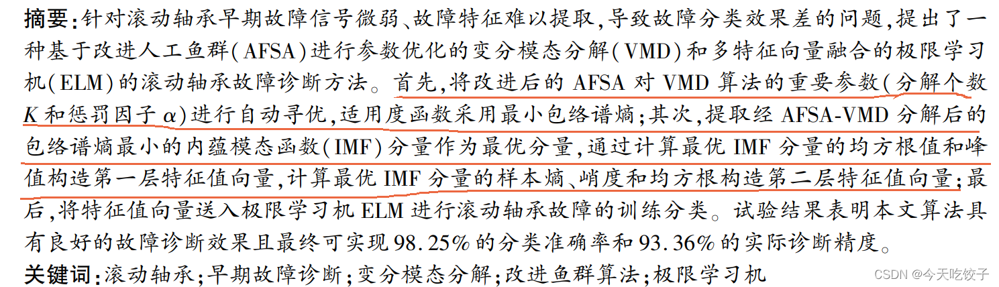

# Optimizing VMD parameters with Baijiang Algorithm, using minimum entropic envelope as the fitness function and extracting feature vectors.

The selection of charging for the author's work is contrary to their original intention, but due to the author discovering that too many people are using the freely available materials directly for commercial purposes, even engaging in malicious competition, they have decided to charge a fee for organizing and compiling these resources. We kindly ask for your understanding.
The White Whale Optimization Algorithm is employed to optimize the parameters of VMD, with the minimum envelop entropy serving as the fitness function. The corresponding IMF components that yield the minimum envelop entropy are extracted. Nine time-domain indicators for the optimal IMF components are collected: mean, variance, peak, kurtosis, effective value, peak factor, impulse factor, waveform factor, and margin factor. A feature vector is then extracted. Taking data from Xichu University as an example. The general approach is to modify his algorithm into the White Whale Optimization Algorithm.
Editor

## Images

<!-- PAYMENT_BLOCK -->

## Get this dataset

- Payment link (Stripe): [Buy now](https://buy.stripe.com/3cs8yP7sY87d0vu9AB)
- Payment QR code: 

<!-- /PAYMENT_BLOCK -->
